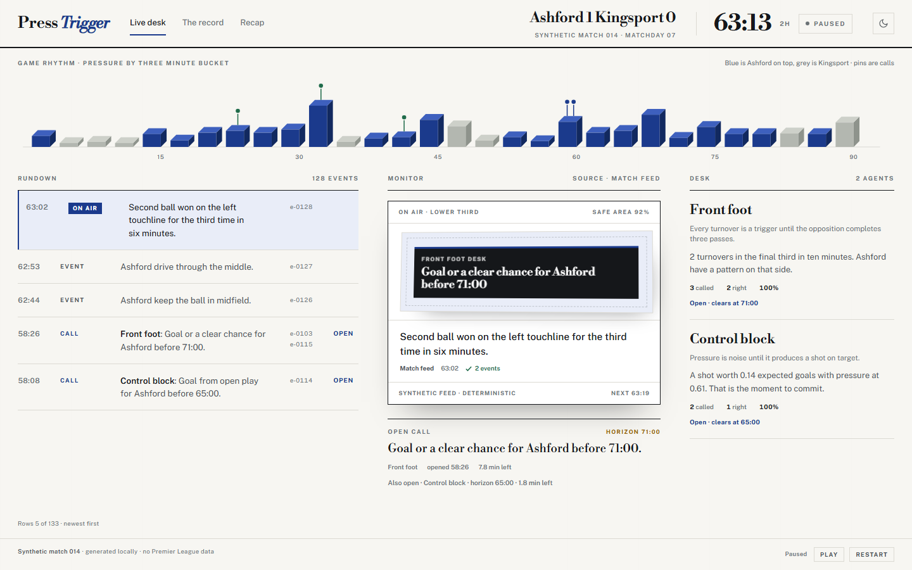
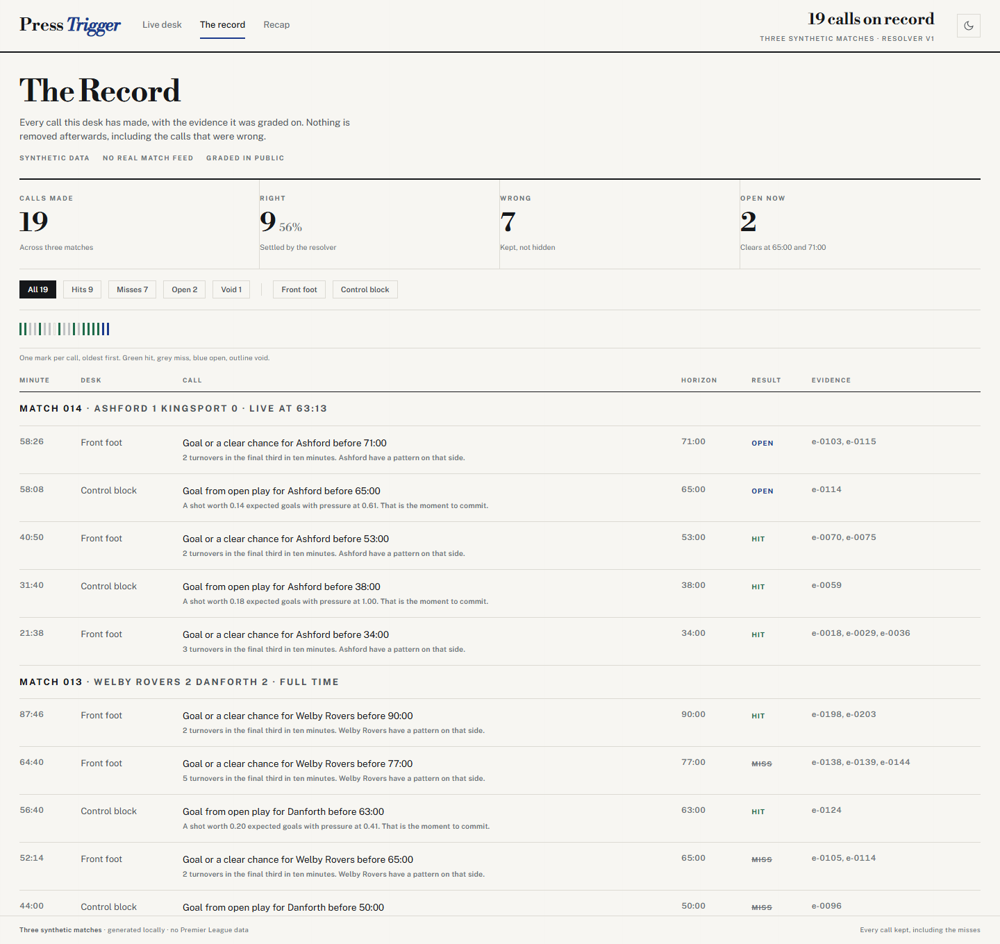
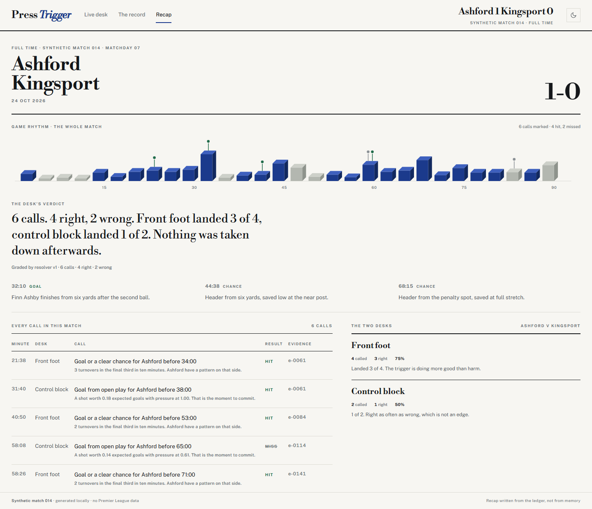
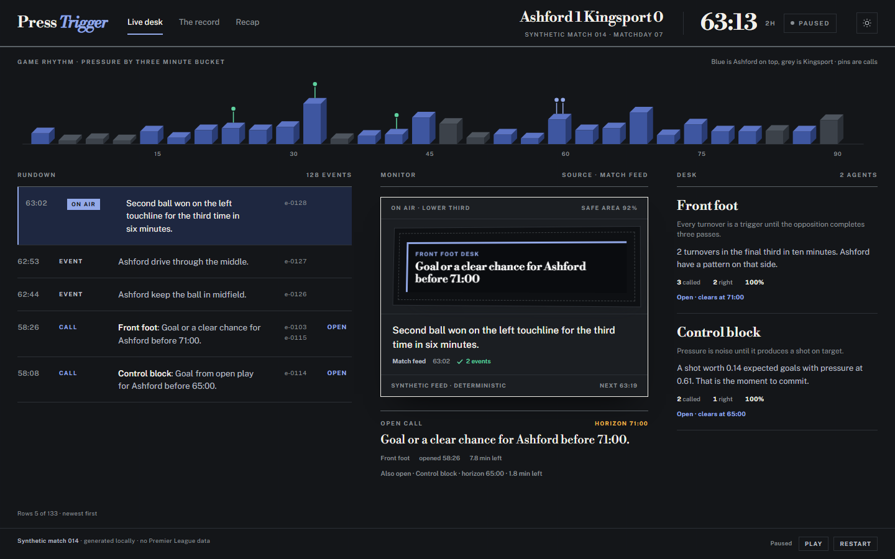

# Press Trigger

**Two pundits. One of them has to be wrong.**

Press Trigger is an accountable football commentary desk. Two agents watch the same match, read it differently, and each one commits to a falsifiable call with a time horizon. A deterministic resolver grades every call hit, miss or void against the feed. Every call is kept, including the ones that were wrong.

Built for the Microsoft x Premier League "Inside the Game" developer hackathon.

---

## It is not live data

Worth stating before anything else: **the matches are synthetic.** There is no Premier League feed, no Opta or StatsBomb licence, and no network call at runtime. Each match is a seeded generator wrapped around authored key moments, so the same match is identical on every run. That is what makes the ledger testable and the demo reproducible.

What is live is the **grading**. The desk replays match 014 from 63:13 at one minute per 2.2 seconds. When the clock passes a call's horizon, the resolver settles it in front of you. At 65:00 control block's goal call is graded a miss. At 68:15 front foot's chance call is graded a hit. The events were fixed in advance. The verdict was not written in advance.

Real data can be dropped in later without touching the product. The feed boundary is one module: `lib/generate.ts` returns a `Match`, and everything downstream only reads that shape. Point it at a real event stream and the desks, resolver, ledger and recap keep working.

---

## Screenshots

**The live desk.** Rundown on the left, the broadcast monitor and the open calls in the middle, both desks and their records on the right. The ribbon is pressure by three minute bucket, with a pin on every call.



**The Record.** Every call, its evidence, and its grade. The one call the feed corrupted is marked void instead of quietly graded.



**The recap.** Full time verdict, the calls that settled it, and a scorecard for each desk.



**The same system in dark.** Not a second design: the same type, rules and accent, with the tokens inverted.



---

## How it works

### 1. The feed

Each match is generated from a seed. Authored key moments carry the story, and the passes and turnovers around them are generated from the same seed. Pressure is derived from the events, not hand drawn.

### 2. Two desks, two priors

- **Front foot** calls when a team wins the ball in the final third twice inside ten minutes. It does not call before the twentieth minute and it waits twelve minutes between calls.
- **Control block** refuses to call pressure alone. It commits only when a shot worth at least 0.12 expected goals arrives, with the pressure index above 0.3.

Neither desk can hedge. A call is a claim, a team, a horizon and the ids of the events that triggered it, and it is written the moment it is made.

### 3. The resolver

| Question | Rule |
| --- | --- |
| Does a goal call hit? | A goal by the named team after the call and on or before the horizon |
| Does a chance call hit? | A goal or a clear chance by the named team in that window |
| Can the other team settle it? | No. A call names one team, and only that team counts |
| When is a call void? | When the feed delivered conflicting events inside the window. The resolver refuses to guess |
| When is a call open? | Until the clock passes the horizon |
| Can a call be edited after the fact? | No |

The team rule and the void rule exist because both were bugs first. A Carrow Heath call was once settled by an Ashford chance, and the test suite now pins the behaviour.

### 4. The record

The ledger and the recap are computed from the same match state as the desk. No number on those pages is typed in by hand. The recap's verdict is generated from the calls, so it says what happened, not what would make a better story.

---

## The three matches at full time

| Match | Fixture | Score | Calls | Right | Wrong | Void |
| --- | --- | --- | --- | --- | --- | --- |
| 014 | Ashford v Kingsport | 1-0 | 6 | 4 | 2 | 0 |
| 013 | Welby Rovers v Danforth | 2-2 | 7 | 3 | 3 | 1 |
| 012 | Carrow Heath v Ashford | 1-2 | 7 | 3 | 4 | 0 |
| **All** | | | **20** | **10** | **9** | **1** |

The Record page opens on match 014 at 63:13, so it shows 19 calls with 2 still open. The full time numbers are above.

---

## Routes

| Route | What it is |
| --- | --- |
| `/match/m14` | The live desk for match 014. Also `/match/m13` and `/match/m12` |
| `/ledger` | The Record: every call across three matches, with filters, marks and evidence |
| `/recap/m14` | The full time read for one match. Also `/recap/m13` and `/recap/m12` |

`/` redirects to the live desk. The tally bar switches between the three. The sun and moon button switches theme, and the choice is remembered in local storage.

---

## Run it

Node 22.18 or newer. The test runner executes TypeScript directly, which needs type stripping.

```
npm install
npm test
npm run dev
```

Open http://localhost:3000.

For a production run:

```
npm run build
npm start
```

### Demo controls

The live desk starts at 63:13 and runs at one minute per 2.2 seconds. `Pause` and `Restart` sit at the bottom right. The clock can be pinned with `?at=63.23&paused=1`, and `?theme=dark` forces dark for a screenshot.

The interesting minute is 63:13. Two calls are open. At 65:00 control block is graded a miss. At 68:15 front foot is graded a hit. At 90 the desk falls silent and the recap has the verdict.

---

## Tests

```
npm test
```

Fifteen tests. They cover the things that would make every screen a lie if they broke:

- the same seed builds the same match, every time
- events are chronological and ids are unique
- pressure has one value per three minute bucket and stays in range
- the score equals the number of goal events
- every call cites evidence that exists, with a horizon inside the match
- a hit has a qualifying event, and a miss has none
- a hit is settled only by the team the call was about
- a void happens only when the feed conflict is inside the window
- the desk never shows a call it has not made yet
- a call that is open at 63:13 is settled by full time
- the feed conflict in match 013 voids exactly one call
- records add up to the calls that were graded
- every match produces at least one hit and one miss
- asking for the same minute twice gives the same state

---

## Stack

- Next.js 16, App Router, every route prerendered
- React 19 and TypeScript
- One hand written stylesheet. No UI framework, no charting library
- No database, no external API, no model call at runtime
- The ribbon is inline SVG drawn from the match state. Its faces read from CSS tokens, so one component serves both themes
- The minute axis is HTML rather than SVG text, so it stays crisp when the chart is compressed on short screens

```
app/
  app/            routes, layout, global stylesheet, icon
  components/     tally bar, theme switch, ribbon, desk, ledger
  lib/            match data, generator, desks, resolver, engine
  tests/          engine tests
  docs/           design system and screenshots
```

---

## Design

`docs/DESIGN.md` has the full system: type scale, palette, the light and dark token tables, the ribbon geometry, and the rules for the read surfaces. The short version: a printed match supplement, not a dashboard. Paper, ink, one blue accent, Bodoni for display and Public Sans for everything else.

---

## Why there is no language model

A deliberate choice. The hard part of this product is not prose, it is the commitment and the grade. A model would enrich the reads and make the ledger untestable, and a judge cannot check a claim that changes between runs.

The architecture leaves room for one. Desks return `Call` objects and the resolver grades them. Swapping a model in behind the front foot desk changes one module and no tests about grading.

---

## Limits, stated plainly

- The matches are synthetic, and the product says so on every page.
- One match at a time. Three matches exist, one of them live.
- Preferences live in local storage. There are no accounts.
- The replay clock is a demo device. A production desk would consume a live stream and keep the same ledger.

---

## Deploy

Import the repository into Vercel. No environment variables. Build command `npm run build`. Node 22.18 or newer.

---

## Licence

MIT. See [LICENSE](LICENSE).
